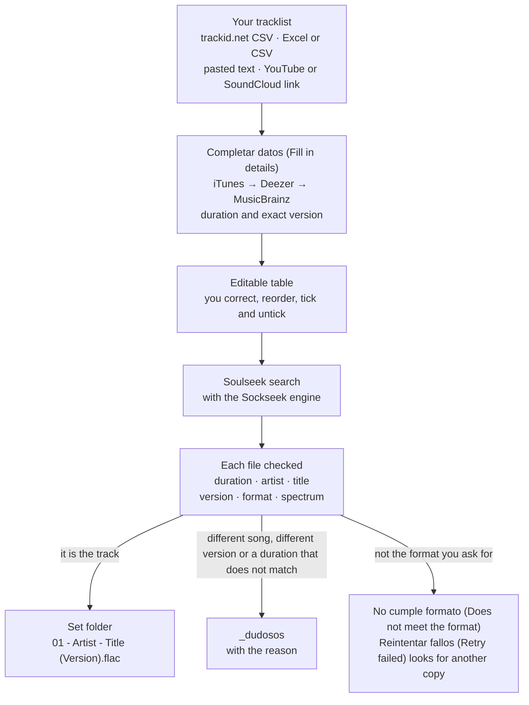

[Español](README.md) · **English**

<div align="center">

<picture>
  <source media="(prefers-color-scheme: dark)" srcset="docs/readme/logo-dark.png">
  
</picture>

<p><strong>From a set's tracklist to a folder of verified music, numbered in set order.</strong></p>

<p>
  <a href="https://github.com/blessel-dev/tracklister/releases/latest"></a>
  <a href="https://github.com/blessel-dev/tracklister/releases"></a>
  <a href="https://github.com/blessel-dev/tracklister/actions/workflows/release.yml"></a>
  <br>
  
  <a href="LICENSE"></a>
  
  
</p>

<p>
  <a href="https://github.com/blessel-dev/tracklister/releases/latest"></a>
</p>

<p>
  <a href="https://github.com/blessel-dev/tracklister/releases/latest">Download the latest release</a> ·
  <a href="https://blessel-dev.github.io/tracklister/en/">Website</a> ·
  <a href="docs/GUIA.md">User guide (in Spanish)</a> ·
  <a href="#frequently-asked-questions">FAQ</a> ·
  <a href="README.md">En español</a>
</p>

<picture>
  <source media="(prefers-color-scheme: dark)" srcset="docs/readme/nuevo-set-noche.png">
  
</picture>

<sub>“Nuevo set” (New set) with the tracklist of a public set, imported from the trackid.net CSV. You'll see the Hormigón (concrete, light) or the Noche (night, dark) theme depending on whether you use GitHub in light or dark mode.</sub>

</div>

Tracklister is a desktop app for DJs, for Windows 10 and 11 (64-bit). You give it a set's tracklist and the app searches Soulseek for each track, checks that each file is the track and the version the tracklist asks for, and leaves you the set in order in a folder. Its interface is in Spanish, it's free software and it comes with no account: everyone uses their own.

## What it does

- **One folder per set, in order.** Each file carries the number of its row in the set: `01 - Artist - Title (Version).flac`.
- **Checks every file.** Duration, artist, title, version (Original, Extended, Remix, Radio Edit…), format and spectrum. It never accepts a doubtful file without telling you: if it may be a different song or version, it moves it to `_dudosos` (the “doubtful” folder) with the reason.
- **Sticks to your format.** Lossless, “CDJ antiguos” (Old CDJs: AIFF or WAV, and it converts the FLACs), “Solo MP3 320” (MP3 320 only: CBR checked in the file itself) or “Personalizado” (Custom).
- **Knows what you already have.** If you already downloaded a track in an earlier set, it asks whether to copy it to this set or download it again.
- **Reads the tracklist wherever you have it.** The trackid.net CSV, an Excel or CSV file, pasted text (1001tracklists, MixesDB, a comment) or the link to a set on YouTube or SoundCloud, where it picks the best tracklist from the description, the chapters and the comments. If you have two lists of the same set, it merges them by each track's start time.
- **And for afterwards:** “Copiar tracklist” (Copy tracklist) with timestamps for Mixcloud or Instagram, a report per set, and “Reordenar” (Reorder) to number folders you already had.

## Why

Downloading a whole set from Soulseek, by hand or in batches, usually ends in three problems. Tracklister is built to avoid them.

| The problem | What Tracklister does |
|---|---|
| **Wrong songs.** The radio edit instead of the original, a remix that wasn't the one, “Dust 2” for “Dust 1”, or another artist with a similar name. | It compares each file with its row: the artist word by word, the title, the version, the numbers in the title and the duration (from iTunes, Deezer or MusicBrainz, or from your table). If it may be a different song or version, the file goes to `_dudosos` with the reason and never enters the set as if it were right. |
| **Wrong formats.** A VBR MP3 sold as 320, a “FLAC” that actually came from an MP3, a FLAC for CDJs that can't read it. | It reads the file itself: it requires CBR MP3 (320 kbps by default), checks that a WAV or an AIFF holds lossless audio, flags likely converted MP3s by their spectrum and, with “CDJ antiguos”, converts the FLACs to AIFF. |
| **Files out of order.** Each file arrives with the name another user gave it, in the order it finishes downloading. | It names each file `NN - Artist - Title (Version).ext` with the number of its row in the set, never the download order. It never overwrites anything, and running a set again doesn't download again what's already fine. |

## How it works



- **“Completar datos”** (Fill in details) asks iTunes, then Deezer and then MusicBrainz for the duration and the exact version of each track, when you import and again when you press “Descargar” (Download) if any is missing. It only sends the artist and the title. With that duration, the engine filters on Soulseek and Tracklister then checks each file.
- **Everything goes through a table you can edit.** You correct the artist, title or version, and move rows up or down, add them or remove them. Each row's number is the one its file will get. The “ID” rows are left unticked.
- **The gaps in a trackid.net CSV are measured with the real duration.** Its Start and End columns say when trackid.net recognized each track in the set, not how long it lasts. An “ID (hueco)” (ID, gap) row is a stretch of the set that trackid.net didn't identify: it only appears if, even with the previous track playing in full (with its duration from iTunes, Deezer or MusicBrainz), more than 90 s are left uncovered before the next one. It keeps its number, so the numbering follows the set's, and its note shows the math: “4:13 sin cubrir aunque «Trip» sonara entero” (4:13 uncovered even if “Trip” played in full).
- **Two lists of the same set are merged by time.** With “Añadir otra fuente del mismo set” (Add another source for the same set), for example the trackid.net CSV and the YouTube comment, each track missing from the first list goes into its place by its start time: if that stretch holds an “ID” row or a gap, it takes its place and its number. The first list has the final say on names. If the set already has files and one of them would have to change its number, it asks you first; Enter adds them at the end without changing any number.
- **If a track doesn't turn up on Soulseek, it tries other spellings.** It searches each name of an “X aka Y” separately, “Vkn.modular” as “Vkn modular”, and “TR440” as “TR 440” and “TR-440”. The name in the table and in the file doesn't change, and the reason says which spelling found it. “Reintentar fallos” (Retry failed) also tries the engine's deep search.
- **Each file gets a confidence score from 0 to 100.** With 80 or more it's “Verificado” (Verified). From 50 to 79 it stays in the set, flagged for review. Below that, or if it's a different song, a different version or the duration is more than 10 s off, it goes to `_dudosos`.
- **The spectrum analysis is a hint, not proof.** A sharp cutoff below 19.5 kHz is that of an MP3 at 256 kbps or less converted to lossless: the file shows “Verificado · revisar calidad” (Verified · check quality), stays in the set with its number, and “Reintentar fallos” looks for another copy. A cutoff between 19.5 and 20.8 kHz is as common in a 320 MP3 as in a legitimate master, so it gets no flag: just a line in the report.

## Screenshots

| Hormigón (concrete: light, the default) | Noche (night: dark) |
|:---:|:---:|
|  |  |

<sub>The theme is chosen in “Ajustes” → “Tema” (Settings → Theme); it applies at once and is remembered for next time.</sub>


<sub>“Descarga” (Download): each track with its state, as an icon and text. Below, the reasons for the selected track. While it downloads, the “Estado” (Status) column shows with a bar how each track is going. When it finishes: “Reintentar fallos” (Retry failed), “Copiar tracklist” (Copy tracklist), “Abrir informe” (Open report) and “Abrir carpeta” (Open folder). Screenshot made with the test engine, without connecting to Soulseek.</sub>

| First run | A track you already have |
|:---:|:---:|
|  |  |

## Track states

Each state has its icon and its text; color is never the only signal.

| State | What it means | Where the file ends up |
|---|---|---|
|  **Verificado** (Verified) | Artist, title, version, duration and format match (confidence of 80 or more). If no store gives the duration, everything else is checked and the reason says so. | In the set folder, with its number. |
|  **Verificado · revisar calidad** (Verified · check quality) | It's the track, but its spectrum has the cutoff of an MP3 at 256 kbps or less: it may be a converted MP3. Listening won't settle it, because it can sound the same. | In the set folder, with its number. “Reintentar fallos” looks for another copy: if a better one arrives, it replaces this one, which moves to `_dudosos`. |
|  **Ya en biblioteca** (Already in library) | You had it from an earlier set and chose “Usar el que ya tengo” (Use the one I have). | Copied to the set folder, with its number. |
|  **Dudoso** (Doubtful) | It may be a different song or version, or the duration doesn't match. Or else it looks like the right one, but there's something to check (confidence from 50 to 79). | If it may be another track, in `_dudosos`, with the reason. If it only needs a check, in the set, with its number and flagged in the report. It's never deleted. |
|  **No encontrado** (Not found) | No Soulseek file passes the filters. | None. “Reintentar fallos” searches again. |
|  **No cumple formato** (Doesn't meet the format) | A file arrived, but it isn't what your format asks for: a VBR MP3 or one below 320 kbps, a WAV with a lossy codec… | It doesn't enter the set. “Reintentar fallos” looks for another copy, leaving out the user who sent that one. |
|  **Fallida** (Failed) | An error of the engine or of the connection to Soulseek, a user who doesn't respond, a download that doesn't finish or a file that couldn't be saved. | None. “Reintentar fallos” requests it again. |
|  **Omitida** (Skipped) | An unticked row, for example an “ID”. | None; the row keeps its number. |
|  **Pendiente** (Pending) | Not searched for yet, or you canceled the download before it got there. | None yet. |
|  **En curso** (In progress) | It's being searched for, downloaded or checked. The “Estado” (Status) column says so with text and a bar: “Buscando…” (Searching…), “En cola” (Queued), “Descargando 25,9 MB” (Downloading 25.9 MB; with the alternative engine, “Descargando 63 %”) and “Comprobando…” (Checking…). | None yet. |

A set's folder ends up like this:

```text
Music\Tracklister\<set name>\
    01 - Artist - Title (Version).flac
    02 - ...
    _dudosos\        what may be a different song or version, or doesn't match in duration
    _originales\     the original FLACs that "CDJ antiguos" has converted to AIFF
    Informe - <set name>.txt      the set's report
    Tracklist - <set name>.txt    the tracklist with timestamps
    .tracklister\    the set's state and the log of changes
```

## Formats

You choose it at first run and change it in “Ajustes” (Settings).

| Format | What it looks for | What it accepts |
|---|---|---|
| **Lossless** (recommended) | FLAC, WAV or AIFF. | Truly lossless audio. If a track is only available as MP3, it asks you once per set, with the list, and only searches MP3 320 for the ones you tick. |
| **CDJ antiguos** (Old CDJs) | AIFF or WAV and, failing that, FLAC. | For CDJs older than the NXS2, which can't read FLAC. FLACs become AIFF with the same sample rate and bit depth, tags and artwork. Above 48 kHz or 24 bits, it goes down to 48 kHz/24-bit (88.2 and 176.4 kHz go down to 44.1), with a warning. The original stays in `_originales` (originals). As with Lossless, it asks before downloading anything as MP3 320. |
| **Solo MP3 320** (MP3 320 only) | 320 kbps MP3. | 320 kbps CBR MP3, checked in the file itself. VBR, V0 included, doesn't count. |
| **Personalizado** (Custom) | The formats you choose. | You choose the minimum MP3 bitrate (320, 256 or 192 kbps, always CBR), the maximum sample rate and bit depth, and whether it asks you about MP3 when there's no lossless. |

`.m4a` files don't count as lossless in any format, because they may be AAC.

## Installation

1. Download `Tracklister-<version>-win64.zip` from the [latest release](https://github.com/blessel-dev/tracklister/releases/latest) (about 130 MB). There's nothing else to install, not even Python.
2. Right-click the zip → “Extract All…” and open `Tracklister\Tracklister.exe`. Don't open it from inside the zip or move it out of its folder: it needs what sits next to it (`_internal`, `engines` and `tools`).
3. If you get “Windows protected your PC” (SmartScreen), click “More info” and then “Run anyway”. It appears because Tracklister isn't digitally signed yet.
4. Optional: check the zip. In PowerShell, in the folder where you downloaded it:

   ```powershell
   Get-FileHash .\Tracklister-1.0.1-win64.zip -Algorithm SHA256
   ```

   With your zip's name, if it's another version. The value must match the one in `SHA256SUMS.txt`, which is in the same release. PowerShell prints it in uppercase; that doesn't matter.
5. At first run, enter **your own Soulseek account**: it's stored in the Windows Credential Manager, never in a file. If you don't have one yet, pick a new username and password: Soulseek creates the account the first time you connect. Then your library folder (by default `Music\Tracklister`), the format and the port (49998). Read “Antes de empezar” (Before you start), tick “Entendido” (Understood) and press “Empezar” (Start).
6. The first time it searches, Windows Firewall may ask about `sockseek.exe`, the download engine: tick “Private networks” and click “Allow access”.
7. Before downloading a whole set, run a [Diagnóstico](#diagnostics) (Diagnostics) with 5 tracks: it tells you whether your account and your network work.

**To update**, when the app tells you there's a new version: download the new zip, extract it and replace your `Tracklister` folder with the new one. Your settings, your account and your library live outside it and are kept, and the sets you already downloaded still open.

The full guide, with your first set, Settings and what to do if something fails, is in [docs/GUIA.md](docs/GUIA.md) (in Spanish).

## Diagnostics

“Diagnóstico” (Diagnostics) searches Soulseek for a few tracks without downloading them (5 by default, up to 20) and explains each candidate: folder and file, size, kbps, duration, score and why it picks or rejects it. Use it the first time and whenever a track doesn't come out right. “Copiar informe” (Copy report) copies it so you can paste it wherever you ask for help, and it's also saved in `%LOCALAPPDATA%\Tracklister\logs`.

If a track gets no results, the Diagnóstico tries its other spellings, as the download does, and says which one found the candidates. It doesn't use the engine's deep search, to keep it short: “Reintentar fallos” tries that when you download.

The report is redacted: it doesn't include your username, your password or your IP, and the other users appear as peer-1, peer-2… Here is one, made with the test engine (in Spanish, like the app):

```text
Diagnóstico de Tracklister

Fecha: 2026-10-10 23:23
Tracklister 1.0.1  |  Motor sockseek-3.0.5  |  Windows 11 (build 10.0.26100)
Puerto de escucha: 49998

Filas buscadas: 5; con resultados: 4; con un candidato válido: 4; sin resultados o con error: 1.

01. Blasha & Allatt - 8AM in Salford  (duración esperada 6:01)
    - peer-1 | Promos\Blasha & Allatt - 8AM in Salford (Radio Edit).flac | 24.6 MB | ? kbps | ? | 49/100 | rechazado: otra versión (se pedía la original y el archivo es 'Radio Edit')
    - peer-2 | Blasha & Allatt - 8AM in Salford\02 - Blasha & Allatt - 8AM in Salford.flac | 41.3 MB | ? kbps | 6:01 | 100/100 | elegido: aceptable: confianza 100/100

02. Truncate - Dust 1 (Kai Van Dongen Remix)  (duración esperada 4:50)
    - peer-3 | Truncate - Dust\03 - Truncate - Dust 1 (Kai Van Dongen Remix).flac | 43.6 MB | ? kbps | 4:50 | 100/100 | elegido: aceptable: confianza 100/100

03. Chris Liebing - Higher Things (FJAAK Remix)  (duración esperada 4:49)
    - peer-4 | CLR\Chris Liebing - Higher Things (FJAAK Remix).aiff | 66.1 MB | ? kbps | 4:49 | 100/100 | elegido: aceptable: confianza 100/100

04. Komplex aka Jeroen Search - Inject  (duración esperada 4:21)
    Encontrado buscando «Jeroen Search - Inject» (sin resultados buscando «Komplex aka Jeroen Search - Inject»).
    - peer-5 | Jeroen Search\Jeroen Search - Inject.flac | 29.8 MB | ? kbps | 4:21 | 100/100 | elegido: aceptable: confianza 100/100

05. Exos - Glaður Og Reifur  (duración esperada 5:03)
    ! Sin resultados en Soulseek para esta búsqueda.
    Al descargar, «Reintentar fallos» también prueba la búsqueda a fondo del motor (sin la condición de duración, solo por el título y solo por el artista).

Comprobación: este informe no contiene tu usuario, tu contraseña ni direcciones IP; los usuarios de Soulseek aparecen como peer-1, peer-2...
```

## Privacy and security

- **Your account is only in the Windows Credential Manager.** No Tracklister file stores it, and in the logs, the reports and the Diagnóstico it's masked (`***` or `[censurado]`, “censored”).
- **An honest note about the password.** The download engine only accepts the account on its command line (`--user` and `--pass`) or in a file with the password written in it, and Tracklister never creates that file. While the engine is running, another program on your PC could read that command line. So: use a Soulseek password you don't use anywhere else, and don't download from a PC you don't trust.
- **No telemetry.** Tracklister doesn't send usage statistics and has no accounts of its own. This is everything that leaves your PC:
  - to Soulseek, through the engine: your account, your searches and your downloads;
  - to iTunes, Deezer and MusicBrainz, with “Completar datos”: only the artist and the title. If you turn off “Completar datos al importar” (Fill in details on import) in Settings, it only asks them when you press the “Completar datos” button yourself;
  - to YouTube or SoundCloud, through yt-dlp: only when you give it a link;
  - to GitHub: at most once a day, the question of whether there's a new version, and when you press “Buscar actualizaciones” (Check for updates) or “Actualizar yt-dlp” (Update yt-dlp) in Settings. If there's a new version, you see a notice with the link; it never installs anything by itself.
- **Your settings are yours.** They're saved in your Windows user profile (`%APPDATA%\Tracklister`), so each person on the PC has their own.

## Responsible use

- Only download music you have the right to download. Tracklister comes with no account: everyone uses their own and is responsible for what they download and share.
- Tracklister downloads in honest mode: it doesn't advertise shared folders on Soulseek that you don't have. Soulseek works because people share, so when you're not using Tracklister, share your music with [Nicotine+](https://nicotine-plus.org/). If you use both at the same time, use a different account in Nicotine+.

## Frequently asked questions

<details>
<summary><strong>Windows says “Windows protected your PC”. What do I do?</strong></summary>

It's SmartScreen: it appears because Tracklister isn't digitally signed yet. Click “More info” and then “Run anyway”. It usually only happens the first time. If you want to make sure the zip is the right one, compare its SHA-256 with `SHA256SUMS.txt` ([Installation](#installation), step 4).

On Windows 11 with “Smart App Control” turned on, it may block it without giving you that option. Don't turn that protection off just for this: it's a known limitation while the exe isn't signed.

</details>

<details>
<summary><strong>No results arrive, or the downloads don't start.</strong></summary>

Run a [Diagnóstico](#diagnostics) and try this:

- Open TCP port 49998 (or the one you have in Settings) on the router, forwarded to your PC's IP.
- Let `sockseek.exe` (or `sldl.exe`, if you use the alternative engine) through Windows Firewall, on private networks.
- If your provider uses CGNAT, you won't be able to open the port: ask them for a public IP.
- If someone else uses Tracklister on your network, use different ports.
- Don't have the same account open in Nicotine+ or in another Soulseek program: Soulseek would disconnect one of them.

</details>

<details>
<summary><strong>A track shows “Dudoso”. What's in <code>_dudosos</code>?</strong></summary>

The files that may be a different song or version, or whose duration doesn't match. The reason is below the table and in the set's report. The file is never deleted: listen to it, correct the artist, title or version in “Nuevo set” (New set) and download again, or press “Reintentar fallos”, which searches for it again, leaving out the user who gave you that file.

Tracklister prefers one doubt too many to a wrong song. That's why a typo in a short artist name, a tag that only has the surname, or an untagged file whose name only fits once words are dropped from it (with no duration to confirm it) can end up in `_dudosos` even when it's the right one. The reason says which words don't fit.

</details>

<details>
<summary><strong>What does “Verificado · revisar calidad” mean?</strong></summary>

That the file is the track you asked for, but the spectrum of that FLAC, WAV or AIFF cuts off sharply below 19.5 kHz, like that of an MP3 at 256 kbps or less: it may be a converted MP3. Listening won't settle it, because it can sound the same. That's why it never rejects the file: it stays in the set, with its number, and “Reintentar fallos” looks for another copy, leaving out the user who sent that one. If one arrives without the flag, or with a cutoff at least 1 kHz higher, it replaces it, and the flagged file moves to `_dudosos` without being deleted.

A cutoff between 19.5 and 20.8 kHz is as common in a 320 MP3 as in a legitimate master, so the spectrum alone can't tell: it gets no flag, just a line in the report. The analysis can be turned off in Settings.

</details>

<details>
<summary><strong>Why won't it accept my VBR (V0) MP3?</strong></summary>

When a format accepts MP3, Tracklister requires a CBR MP3, and it checks it in the file itself. A VBR, V0 included, shows “No cumple formato” (Doesn't meet the format), and “Reintentar fallos” looks for another copy. Lossless, CDJ antiguos and Solo MP3 320 require 320 kbps; in “Personalizado” you can lower the minimum to 256 or 192 kbps, but always CBR.

</details>

<details>
<summary><strong>Why does an “ID” row keep its number?</strong></summary>

Because each file's number is its row's number in the set, never the download order. An unidentified track (“ID” or “ID (hueco)”) is left unticked, but it keeps its place: if the set has an ID at 07, the folder jumps from 06 to 08, and you can see where it's missing. If you identify it later, type the artist and title into its row and download it: it goes in with its number.

</details>

<details>
<summary><strong>Do I need a Soulseek account?</strong></summary>

Yes, your own: Tracklister doesn't come with one. If you don't have one yet, pick a new username and password at first run; Soulseek creates the account the first time you connect. If that username already exists with another password, it belongs to someone else: pick another name.

</details>

<details>
<summary><strong>Is there a version for macOS or Linux?</strong></summary>

Not yet: Tracklister runs on Windows 10 and 11 (64-bit). macOS is among the ideas on the [roadmap](#roadmap).

</details>

## For developers

**Requirements:** Windows 10 or 11 (64-bit), Python 3.13 (64-bit) and Git.

**From source.** The engines are downloaded pinned by version and checked by SHA-256:

```powershell
git clone https://github.com/blessel-dev/tracklister.git
cd tracklister
py -3.13 -m venv .venv
.\.venv\Scripts\python.exe -m pip install -r requirements-dev.lock.txt
.\.venv\Scripts\python.exe tools\fetch_engine.py      # Sockseek 3.0.5 and sldl 2.6.0
$env:PYTHONPATH = "src"
.\.venv\Scripts\python.exe -m tracklister
```

`requirements.lock.txt` pins the app's dependencies and `requirements-dev.lock.txt` also pins those of the tests, the brand and the packaging. From source, YouTube and SoundCloud links need `yt-dlp.exe` in `%LOCALAPPDATA%\Tracklister\tools\`; the exe copies it there by itself.

**Tests:**

```powershell
.\.venv\Scripts\python.exe -m pytest -q
```

There are 1405 and none of them goes online: a fake engine, an in-memory account instead of the Credential Manager, recorded HTTP responses and a guard that makes any outside connection fail.

**The exe:**

```powershell
.\.venv\Scripts\python.exe packaging\fetch_ytdlp.py   # pinned yt-dlp, checked by SHA-256
.\.venv\Scripts\python.exe packaging\build.py --zip   # dist\Tracklister\ and dist\release\
.\.venv\Scripts\python.exe packaging\smoke_test.py    # the exe starts without Python and reaches the first run
```

PyInstaller in folder mode, without UPX. `build.py` adds the engines, yt-dlp and every license, and rejects the package if something is missing or something that must not go in is there.

**Releases.** When you push a `v<version>` tag, which must be the app's version, `.github/workflows/release.yml` runs the tests on a Windows runner, builds the exe, tests it without Python and publishes the release with the zip, the source code of both engines and `SHA256SUMS.txt`. The repo's owner (`blessel-dev`) is in the code: the update notice and the User-Agent that MusicBrainz sees come from it. In a fork, the workflow keeps it and leaves a warning.

**Architecture.** The code is in `src/tracklister/`:

- `inputs` reads the tracklists (trackid.net CSV, tables, pasted text and comments through yt-dlp) and combines sources;
- `enrich` fills in the duration and the version with iTunes, Deezer and MusicBrainz;
- `engine` is the engines' only adapter: command line, formats, search limit and the account in the keyring;
- `verify` decides about each file: identity, version, duration, quality, spectrum and the conversion to AIFF;
- `organize` names and places the files and does “Reordenar”, always with a log to undo it;
- `pipeline` runs each set's session, the retries and the report;
- `library` remembers the tracks of earlier sets, and `diagnostics` runs the Diagnóstico and redacts it;
- `net` is the shared HTTP client and the update notice, `gui` the PySide6 interface and `core` the model, the settings and the paths.

**Quality.** Besides the 1405 offline tests, the code went through 6 full external audits before 1.0.0 and 3 more before 1.0.1. In both versions, the last one ended with no blocking findings, and every blocking finding was fixed with its test. `tools\secrets_scan.py` counts, without showing them, the possible secrets in everything that would be published, and it must give 0.

## Roadmap

These are plans, not promises.

- **1.0.1**, this version: the fixes from the first real test with Soulseek and a per-track progress bar while it downloads.
- **1.0.2**: the minor details that the 1.0.1 audits left noted.
- **Ideas for later:** identifying a set from its audio, publishing the tracklist to Mixcloud, checking each file by its acoustic fingerprint (AcoustID), signing the exe so that SmartScreen doesn't warn, and a version for macOS.

## Credits and licenses

- **Tracklister** is free software: GPL-3.0-or-later ([LICENSE](LICENSE)).
- **Download engine:** [Sockseek](https://github.com/fiso64/sockseek) 3.0.5, by fiso64 (AGPL-3.0), and as an alternative sldl 2.6.0 (slsk-batchdl), also by fiso64 (GPL-3.0). They ship unmodified, as separate programs, and every release includes their exact source code.
- **yt-dlp** (The Unlicense), to read the comments on YouTube and SoundCloud.
- **Libraries:** Qt 6 and PySide6 (LGPL-3.0), mutagen (GPL-2.0-or-later), libsndfile (LGPL-2.1-or-later) with soundfile (BSD-3-Clause), numpy (BSD-3-Clause and other licenses), openpyxl, RapidFuzz and keyring (MIT), and requests (Apache-2.0).
- **Fonts:** Inter and JetBrains Mono (SIL Open Font License 1.1).
- **Data:** “Completar datos” uses the public searches of iTunes, Deezer and MusicBrainz.
- The full list, with versions, licenses and links to the source code, is in [third_party/NOTICES.md](third_party/NOTICES.md).
- The **Blessel** logo and name are the creator's signature. As section 7(e) of the GPL-3.0 allows, the license grants no trademark rights to them.

## Made by Blessel

Tracklister is a Blessel project, made to prepare his sets and his friends'. More from Blessel on [Mixcloud](https://www.mixcloud.com/blessel/), on [MavelPoint](https://www.mavelpoint.com/artist/blessel/overview) and on [Instagram](https://www.instagram.com/blessel.live/). Tracklister's website: https://blessel-dev.github.io/tracklister/en/

## En español

**Tracklister** es una app de escritorio gratuita para DJs, para Windows 10 y 11 (64 bits), con la interfaz en español.
Lee el README completo en español: **[README.md](README.md)**.
