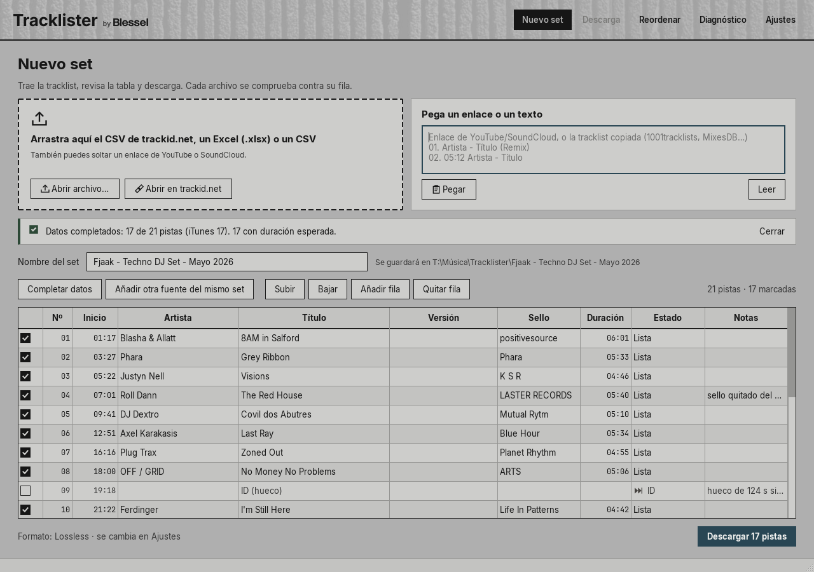
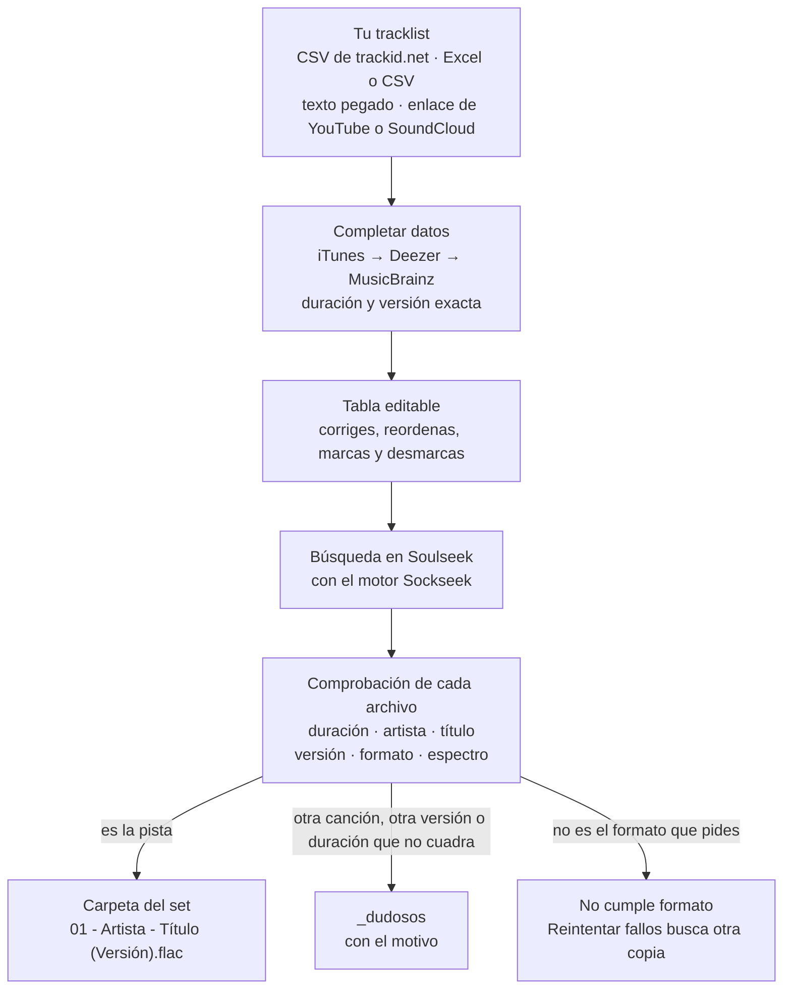
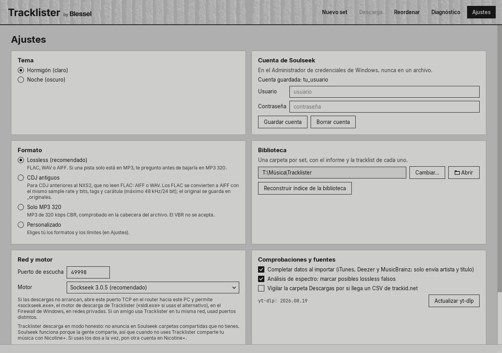
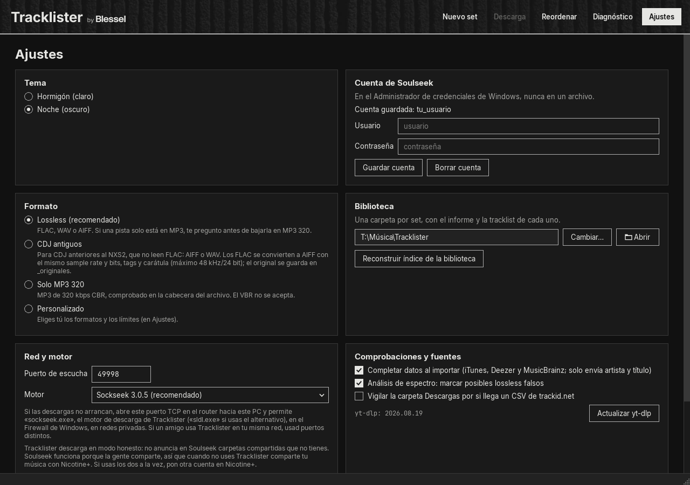
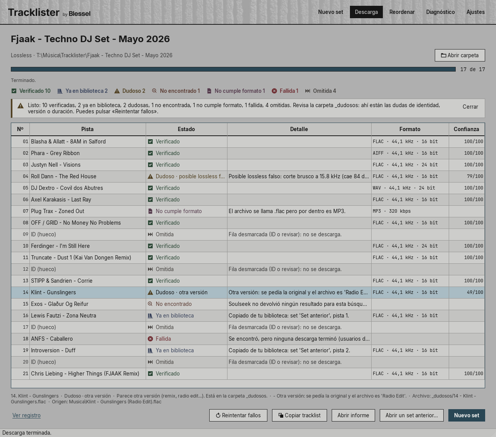
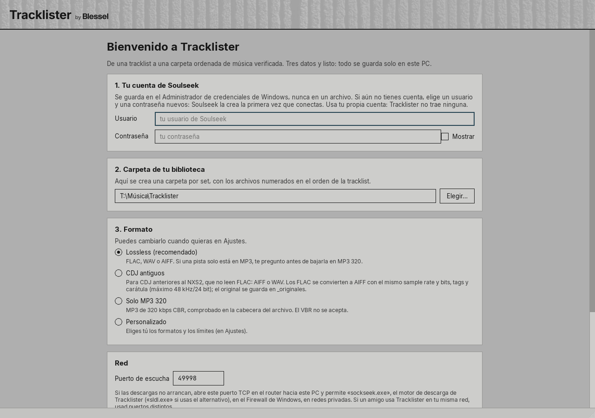
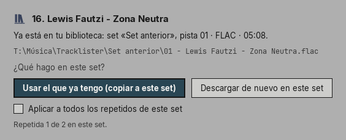

<div align="center">

<picture>
  <source media="(prefers-color-scheme: dark)" srcset="docs/readme/logo-dark.png">
  
</picture>

<p><strong>De la tracklist de un set a una carpeta de música verificada, numerada en el orden del set.</strong></p>

<p>
  <a href="https://github.com/blessel-dev/tracklister/releases/latest"></a>
  <a href="https://github.com/blessel-dev/tracklister/releases"></a>
  <a href="https://github.com/blessel-dev/tracklister/actions/workflows/release.yml"></a>
  <br>
  
  <a href="LICENSE"></a>
  
  
</p>

<p>
  <a href="https://github.com/blessel-dev/tracklister/releases/latest"></a>
</p>

<p>
  <a href="https://github.com/blessel-dev/tracklister/releases/latest">Descargar la última versión</a> ·
  <a href="docs/GUIA.md">Guía de uso</a> ·
  <a href="#preguntas-frecuentes">Preguntas frecuentes</a> ·
  <a href="#in-english">In English</a>
</p>

<picture>
  <source media="(prefers-color-scheme: dark)" srcset="docs/readme/nuevo-set-noche.png">
  
</picture>

<sub>«Nuevo set» con la tracklist de un set público, importada del CSV de trackid.net. Verás el tema Hormigón o el Noche según uses GitHub en modo claro u oscuro.</sub>

</div>

Tracklister es una app de escritorio para DJs, para Windows 10 y 11. Le pasas la tracklist de un set y la app busca cada pista en Soulseek, comprueba que cada archivo es la pista y la versión que pide la tracklist y te deja el set ordenado en una carpeta. Está en español, es software libre y no trae ninguna cuenta: cada persona usa la suya.

## Qué hace

- **Una carpeta por set, en orden.** Cada archivo lleva el número de su fila en el set: `01 - Artista - Título (Versión).flac`.
- **Comprueba cada archivo.** Duración, artista, título, versión (Original, Extended, Remix, Radio Edit…), formato y espectro. Nunca acepta un archivo dudoso sin decírtelo: lo aparta a `_dudosos` con el motivo.
- **Respeta tu formato.** Lossless, CDJ antiguos (AIFF o WAV, y convierte los FLAC), Solo MP3 320 (CBR comprobado en el propio archivo) o Personalizado.
- **Sabe lo que ya tienes.** Si una pista ya la bajaste en un set anterior, te pregunta si la copias a este set o la descargas otra vez.
- **Lee la tracklist de donde la tengas.** El CSV de trackid.net, un Excel o un CSV, texto pegado (1001tracklists, MixesDB, un comentario) o el enlace de un set de YouTube o SoundCloud, del que elige el comentario con la tracklist.
- **Y para después:** «Copiar tracklist» con tiempos para Mixcloud o Instagram, un informe por set y «Reordenar» para numerar carpetas que ya tenías.

## Por qué

Bajar un set entero de Soulseek, a mano o por lotes, suele acabar en tres problemas. Tracklister está hecho para evitarlos.

| El problema | Lo que hace Tracklister |
|---|---|
| **Canciones equivocadas.** El radio edit en vez de la original, un remix que no era, «Dust 2» por «Dust 1» u otro artista con un nombre parecido. | Compara cada archivo con su fila: el artista palabra por palabra, el título, la versión, los números del título y la duración que dan las tiendas. Si puede ser otra canción u otra versión, el archivo va a `_dudosos` con el motivo y nunca entra en el set como si fuera bueno. |
| **Formatos equivocados.** Un MP3 VBR que se anuncia como 320, un «FLAC» que en realidad salió de un MP3, un FLAC para unos CDJ que no lo leen. | Lee el propio archivo: exige MP3 CBR de 320 kbps, comprueba que un WAV o un AIFF lleve audio sin pérdida, marca los posibles lossless falsos por su espectro y, con «CDJ antiguos», convierte los FLAC a AIFF. |
| **Archivos desordenados.** Cada archivo llega con el nombre que le puso otro usuario y en el orden en que termina de bajar. | Nombra cada archivo `NN - Artista - Título (Versión).ext` con el número de su fila en el set, nunca con el orden de descarga. Nunca sobrescribe nada, y repetir un set no vuelve a bajar lo que ya está bien. |

## Cómo funciona



- **«Completar datos»** pregunta a iTunes, luego a Deezer y luego a MusicBrainz la duración y la versión exacta de cada pista, al importar y otra vez al pulsar «Descargar» si falta alguna. Solo envía artista y título. Con esa duración, el motor filtra en Soulseek y Tracklister comprueba después cada archivo.
- **Todo pasa por una tabla que puedes editar.** Corriges artista, título o versión, y subes, bajas, añades o quitas filas. El número de cada fila es el que llevará su archivo. Las filas «ID» van desmarcadas, y los huecos de más de 90 s del CSV de trackid.net salen como «ID (hueco)», para que la numeración siga la del set.
- **Cada archivo lleva una confianza de 0 a 100.** Con 80 o más es «Verificado». De 50 a 79 se queda en el set, marcado para revisar. Por debajo, o si es otra canción, otra versión o la duración se aleja más de 10 s, va a `_dudosos`.
- **El análisis de espectro es una pista, no una prueba.** Marca «posible lossless falso» y deja el archivo en el set, con su número, para que lo escuches y decidas tú.

## Capturas

| Hormigón (claro, el de serie) | Noche (oscuro) |
|:---:|:---:|
|  |  |

<sub>El tema se elige en «Ajustes» → «Tema», se aplica al momento y se recuerda para la próxima vez.</sub>



<sub>«Descarga»: cada pista con su estado, con icono y texto. Debajo, los motivos de la pista seleccionada. Al terminar: «Reintentar fallos», «Copiar tracklist», «Abrir informe» y «Abrir carpeta». Captura hecha con el motor de pruebas, sin conectar a Soulseek.</sub>

| Primer inicio | Una pista que ya tienes |
|:---:|:---:|
|  |  |

## Estados de cada pista

Cada estado lleva su icono y su texto; el color nunca va solo.

| Estado | Qué significa | Dónde queda el archivo |
|---|---|---|
|  **Verificado** | Cuadran artista, título, versión, duración y formato (confianza de 80 o más). | En la carpeta del set, con su número. |
|  **Ya en biblioteca** | La tenías de un set anterior y elegiste «Usar el que ya tengo». | Copiada a la carpeta del set, con su número. |
|  **Dudoso** | Puede ser otra canción u otra versión, o la duración no cuadra. O bien parece la buena pero hay algo que revisar: confianza de 50 a 79 o «posible lossless falso». | Si puede ser otra pista, en `_dudosos`, con el motivo. Si solo hay que revisarla, en el set, con su número y marcada en el informe. Nunca se borra. |
|  **No encontrado** | Ningún archivo de Soulseek pasa los filtros. | Ninguno. «Reintentar fallos» vuelve a buscar. |
|  **No cumple formato** | Llegó un archivo, pero no es lo que pide tu formato: un MP3 VBR o de menos de 320 kbps, un WAV con un códec con pérdida… | No entra en el set. «Reintentar fallos» busca otra copia, sin el usuario que mandó esa. |
|  **Fallida** | Un error del motor, un usuario que no responde, una descarga cancelada o un archivo que no se pudo guardar. | Ninguno. «Reintentar fallos» la vuelve a pedir. |
|  **Omitida** | Una fila desmarcada, por ejemplo un «ID». | Ninguno; la fila conserva su número. |
|  **Pendiente** | Aún no se ha buscado. | Todavía ninguno. |
|  **En curso** | Se está buscando o descargando. | Todavía ninguno. |

La carpeta de un set queda así:

```text
Música\Tracklister\<nombre del set>\
    01 - Artista - Título (Versión).flac
    02 - ...
    _dudosos\        lo que puede ser otra canción u otra versión, o no cuadra en duración
    _originales\     los FLAC originales que «CDJ antiguos» ha pasado a AIFF
    Informe - <nombre del set>.txt
    Tracklist - <nombre del set>.txt
    .tracklister\    el estado del set y el registro de cambios
```

## Formatos

Se elige en el primer inicio y se cambia en Ajustes.

| Formato | Qué busca | Qué acepta |
|---|---|---|
| **Lossless** (recomendado) | FLAC, WAV o AIFF. | Audio sin pérdida de verdad. Si alguna pista solo está en MP3, te pregunta una vez por set, con la lista, y solo busca en MP3 320 las que marques. |
| **CDJ antiguos** | AIFF o WAV y, si no, FLAC. | Para CDJ anteriores al NXS2, que no leen FLAC. Los FLAC pasan a AIFF con el mismo sample rate y bits, tags y carátula. Por encima de 48 kHz o 24 bits, baja a 48 kHz/24 bits (88,2 y 176,4 kHz bajan a 44,1), con aviso. El original queda en `_originales`. Como en Lossless, pregunta antes de bajar algo en MP3 320. |
| **Solo MP3 320** | MP3 de 320 kbps. | MP3 CBR de 320 kbps, comprobado en el propio archivo. El VBR, también el V0, no vale. |
| **Personalizado** | Los formatos que elijas. | Tú eliges el MP3 mínimo (320, 256 o 192 kbps, siempre CBR), el sample rate y los bits máximos, y si te pregunta por el MP3 cuando no hay lossless. |

Los `.m4a` no cuentan como lossless en ningún formato, porque pueden ser AAC.

## Instalación

1. Descarga `Tracklister-<versión>-win64.zip` de la [última versión](https://github.com/blessel-dev/tracklister/releases/latest) (unos 130 MB). No hace falta instalar nada más, tampoco Python.
2. Clic derecho en el zip → «Extraer todo…» y abre `Tracklister\Tracklister.exe`. No lo abras desde dentro del zip ni lo saques de su carpeta: necesita lo que tiene al lado (`_internal`, `engines` y `tools`).
3. Si sale «Windows protegió su PC» (SmartScreen), pulsa «Más información» y luego «Ejecutar de todas formas». Sale porque Tracklister aún no está firmado digitalmente.
4. Opcional: comprueba el zip. En PowerShell, en la carpeta donde lo bajaste:

   ```powershell
   Get-FileHash .\Tracklister-1.0.0-win64.zip -Algorithm SHA256
   ```

   El valor tiene que ser el mismo que pone `SHA256SUMS.txt`, que está en la misma Release.
5. En el primer inicio pon **tu propia cuenta de Soulseek**: se guarda en el Administrador de credenciales de Windows, nunca en un archivo. Si aún no tienes, elige un usuario y una contraseña nuevos: Soulseek crea la cuenta la primera vez que conectas. Después, la carpeta de tu biblioteca (de serie, `Música\Tracklister`), el formato y el puerto (49998). Lee «Antes de empezar», marca «Entendido» y pulsa «Empezar».
6. La primera vez que busque, el Firewall de Windows puede preguntar por `sockseek.exe`, el motor de descarga: marca «Redes privadas» y pulsa «Permitir acceso».
7. Antes de bajar un set entero, haz un [Diagnóstico](#diagnóstico) con 5 pistas: te dice si tu cuenta y tu red funcionan.

La guía completa, con tu primer set, Ajustes y qué hacer si algo falla, está en [docs/GUIA.md](docs/GUIA.md).

## Diagnóstico

El Diagnóstico busca unas pocas pistas en Soulseek sin descargarlas (5 de serie, hasta 20) y explica cada candidato: carpeta y archivo, tamaño, kbps, duración, puntuación y por qué lo elige o lo rechaza. Úsalo la primera vez y siempre que una pista no salga bien. «Copiar informe» lo copia para pegarlo donde pidas ayuda, y también se guarda en `%LOCALAPPDATA%\Tracklister\logs`.

El informe va censurado: no lleva tu usuario, tu contraseña ni tu IP, y los demás usuarios salen como peer-1, peer-2… Así es uno, hecho con el motor de pruebas:

```text
Diagnóstico de Tracklister

Fecha: 2026-10-10 13:16
Tracklister 1.0.0  |  Motor sockseek-3.0.5  |  Windows 11 (build 10.0.26100)
Puerto de escucha: 49998

Filas buscadas: 4; con resultados: 3; con un candidato válido: 3; sin resultados o con error: 1.

01. Blasha & Allatt - 8AM in Salford  (duración esperada 6:01)
    - peer-1 | Promos\Blasha & Allatt - 8AM in Salford (Radio Edit).flac | 24.6 MB | ? kbps | ? | 49/100 | rechazado: otra versión (se pedía la original y el archivo es 'Radio Edit')
    - peer-2 | Blasha & Allatt - 8AM in Salford\02 - Blasha & Allatt - 8AM in Salford.flac | 41.3 MB | ? kbps | 6:01 | 100/100 | elegido: aceptable: confianza 100/100

02. Truncate - Dust 1 (Kai Van Dongen Remix)  (duración esperada 4:50)
    - peer-3 | Truncate - Dust\03 - Truncate - Dust 1 (Kai Van Dongen Remix).flac | 43.6 MB | ? kbps | 4:50 | 100/100 | elegido: aceptable: confianza 100/100

03. Chris Liebing - Higher Things (FJAAK Remix)  (duración esperada 4:49)
    - peer-4 | CLR\Chris Liebing - Higher Things (FJAAK Remix).aiff | 66.1 MB | ? kbps | 4:49 | 100/100 | elegido: aceptable: confianza 100/100

04. Exos - Glaður Og Reifur  (duración esperada 5:03)
    ! Sin resultados en Soulseek para esta búsqueda.

Comprobación: este informe no contiene tu usuario, tu contraseña ni direcciones IP; los usuarios de Soulseek aparecen como peer-1, peer-2...
```

## Privacidad y seguridad

- **Tu cuenta solo está en el Administrador de credenciales de Windows.** Ningún archivo de Tracklister la guarda, y en los registros, los informes y el Diagnóstico sale `***`.
- **Una nota honesta sobre la contraseña.** El motor de descarga solo acepta la cuenta por su línea de comandos (`--user` y `--pass`) o en un archivo con la contraseña escrita, y Tracklister nunca crea ese archivo. Mientras el motor está en marcha, otro programa de tu PC podría leer esa línea de comandos. Por eso: usa en Soulseek una contraseña que no uses en ningún otro sitio, y no descargues desde un PC en el que no confíes.
- **Sin telemetría.** Tracklister no envía estadísticas de uso ni tiene cuentas propias. Esto es todo lo que sale de tu PC:
  - a Soulseek, a través del motor: tu cuenta, tus búsquedas y tus descargas;
  - a iTunes, Deezer y MusicBrainz, con «Completar datos»: solo artista y título (se puede apagar en Ajustes);
  - a YouTube o SoundCloud, a través de yt-dlp: solo cuando le das un enlace;
  - a GitHub: como mucho una vez al día, la pregunta de si hay una versión nueva, y cuando pulsas «Buscar actualizaciones» o «Actualizar yt-dlp» en Ajustes. Si hay versión nueva, ves un aviso con el enlace; nunca instala nada solo.
- **Tus ajustes son tuyos.** Se guardan en tu usuario de Windows (`%APPDATA%\Tracklister`), así que cada persona del PC tiene los suyos.

## Uso responsable

- Descarga solo música que tengas derecho a descargar. Tracklister no trae ninguna cuenta: cada persona usa la suya y es responsable de lo que descarga y comparte.
- Tracklister descarga en modo honesto: no anuncia en Soulseek carpetas compartidas que no tienes. Soulseek funciona porque la gente comparte, así que, cuando no uses Tracklister, comparte tu música con [Nicotine+](https://nicotine-plus.org/). Si usas los dos a la vez, pon otra cuenta en Nicotine+.

## Preguntas frecuentes

<details>
<summary><strong>Windows dice «Windows protegió su PC». ¿Qué hago?</strong></summary>

Es SmartScreen: sale porque Tracklister aún no está firmado digitalmente. Pulsa «Más información» y luego «Ejecutar de todas formas». Normalmente solo pasa la primera vez. Si quieres asegurarte de que el zip es el bueno, compara su SHA-256 con `SHA256SUMS.txt` ([Instalación](#instalación), paso 4).

En un Windows 11 con «Control inteligente de aplicaciones» activado, puede que lo bloquee sin darte esa opción. No desactives esa protección solo por esto: es una limitación conocida mientras el exe no esté firmado.

</details>

<details>
<summary><strong>No llega ningún resultado o las descargas no arrancan.</strong></summary>

Haz un [Diagnóstico](#diagnóstico) y prueba esto:

- Abre el puerto TCP 49998 (o el que tengas en Ajustes) en el router, hacia la IP de tu PC.
- Deja pasar a `sockseek.exe` (o a `sldl.exe`, si usas el motor alternativo) en el Firewall de Windows, en redes privadas.
- Si tu operador usa CGNAT, no podrás abrir el puerto: pídele una IP pública.
- Si otra persona usa Tracklister en tu misma red, usad puertos distintos.
- No tengas abierta la misma cuenta en Nicotine+ ni en otro programa de Soulseek: Soulseek cortaría una de las dos.

</details>

<details>
<summary><strong>Una pista sale «Dudoso». ¿Qué hay en <code>_dudosos</code>?</strong></summary>

Los archivos que pueden ser otra canción u otra versión, o cuya duración no cuadra. El motivo está debajo de la tabla y en el informe del set. El archivo nunca se borra: escúchalo, corrige artista, título o versión en «Nuevo set» y vuelve a descargar, o pulsa «Reintentar fallos», que la busca otra vez sin el usuario que te dio ese archivo.

Tracklister prefiere una duda de más a una canción equivocada. Por eso una errata en un nombre corto del artista, o una etiqueta que solo trae el apellido, puede acabar en `_dudosos` aunque sea la buena.

</details>

<details>
<summary><strong>¿Qué significa «posible lossless falso»?</strong></summary>

Que el espectro de ese FLAC, WAV o AIFF se corta de golpe en los agudos, como el de un MP3. Es una pista, no una prueba, así que nunca rechaza el archivo: se queda en el set, con su número y una marca en el informe. Escúchalo y decide tú. El análisis se puede apagar en Ajustes.

</details>

<details>
<summary><strong>¿Por qué no acepta mi MP3 VBR (V0)?</strong></summary>

Cuando un formato admite MP3, Tracklister exige un MP3 CBR, y lo comprueba en el propio archivo. Un VBR, también el V0, sale «No cumple formato», y «Reintentar fallos» busca otra copia. Lossless, CDJ antiguos y Solo MP3 320 piden 320 kbps; en «Personalizado» puedes bajar el mínimo a 256 o 192 kbps, pero siempre CBR.

</details>

<details>
<summary><strong>¿Por qué una fila «ID» conserva su número?</strong></summary>

Porque el número de cada archivo es el de su fila en el set, nunca el del orden de descarga. Una pista sin identificar («ID» o «ID (hueco)») va desmarcada, pero guarda su sitio: si el set tiene un ID en el 07, la carpeta salta del 06 al 08, y se ve dónde falta. Si más tarde la identificas, escribe artista y título en su fila y descárgala: entra con su número.

</details>

<details>
<summary><strong>¿Necesito una cuenta de Soulseek?</strong></summary>

Sí, la tuya: Tracklister no trae ninguna. Si aún no tienes, en el primer inicio elige un usuario y una contraseña nuevos; Soulseek crea la cuenta la primera vez que conectas. Si ese usuario ya existe con otra contraseña, es de otra persona: elige otro nombre.

</details>

<details>
<summary><strong>¿Hay versión para macOS o Linux?</strong></summary>

Todavía no: Tracklister funciona en Windows 10 y 11 de 64 bits. macOS está entre las ideas de la [hoja de ruta](#hoja-de-ruta).

</details>

## Para desarrolladores

**Requisitos:** Windows 10 u 11 de 64 bits, Python 3.13 (64 bits) y Git.

**Desde el código.** Los motores se bajan fijados por versión y se comprueban por SHA-256:

```powershell
git clone https://github.com/blessel-dev/tracklister.git
cd tracklister
py -3.13 -m venv .venv
.\.venv\Scripts\python.exe -m pip install -r requirements-dev.lock.txt
.\.venv\Scripts\python.exe tools\fetch_engine.py      # Sockseek 3.0.5 y sldl 2.6.0
$env:PYTHONPATH = "src"
.\.venv\Scripts\python.exe -m tracklister
```

`requirements.lock.txt` fija las dependencias de la app y `requirements-dev.lock.txt`, además, las de tests, marca y empaquetado. Desde el código, los enlaces de YouTube y SoundCloud necesitan `yt-dlp.exe` en `%LOCALAPPDATA%\Tracklister\tools\`; el exe lo copia allí él solo.

**Tests:**

```powershell
.\.venv\Scripts\python.exe -m pytest -q
```

Son 941 y ninguno sale a la red: motor falso, cuenta en memoria en vez del Administrador de credenciales, respuestas HTTP grabadas y un guardián que hace fallar cualquier conexión de fuera.

**El exe:**

```powershell
.\.venv\Scripts\python.exe packaging\fetch_ytdlp.py   # yt-dlp fijado, comprobado por SHA-256
.\.venv\Scripts\python.exe packaging\build.py --zip   # dist\Tracklister\ y dist\release\
.\.venv\Scripts\python.exe packaging\smoke_test.py    # el exe arranca sin Python y llega al primer inicio
```

PyInstaller en modo carpeta, sin UPX. `build.py` añade los motores, yt-dlp y todas las licencias, y rechaza el paquete si falta algo o sobra algo que no debe ir.

**Releases.** Al subir una etiqueta `v<versión>`, que tiene que ser la de la app, `.github/workflows/release.yml` pasa los tests en un runner de Windows, construye el exe, lo prueba sin Python y publica la Release con el zip, el código fuente de los dos motores y `SHA256SUMS.txt`. Mientras el código lleve el marcador del propietario de GitHub, el workflow pone el dueño del repo solo en la build que publica.

**Arquitectura.** El código está en `src/tracklister/`:

- `inputs` lee las tracklists (CSV de trackid.net, tablas, texto pegado y comentarios con yt-dlp) y combina fuentes;
- `enrich` completa duración y versión con iTunes, Deezer y MusicBrainz;
- `engine` es el único adaptador de los motores: línea de comandos, formatos, límite de búsquedas y la cuenta en el keyring;
- `verify` decide sobre cada archivo: identidad, versión, duración, calidad, espectro y la conversión a AIFF;
- `organize` nombra y coloca los archivos y hace «Reordenar», siempre con un registro para deshacer;
- `pipeline` lleva la sesión de cada set, los reintentos y el informe;
- `library` recuerda las pistas de los sets anteriores, y `diagnostics` hace el Diagnóstico y lo censura;
- `net` es el cliente HTTP compartido y el aviso de actualización, `gui` la interfaz en PySide6 y `core` el modelo, los ajustes y las rutas.

**Calidad.** Además de los 941 tests sin conexión, el repo pasó 6 auditorías externas completas antes de la 1.0.0, y cada fallo que bloqueaba se arregló con su test. `tools\secrets_scan.py` cuenta, sin enseñarlos, los posibles secretos de todo lo que se publicaría, y tiene que dar 0.

## Hoja de ruta

Son planes, no promesas.

- **1.0.1**, en preparación: los arreglos de las primeras pruebas reales con Soulseek y una barra de progreso por pista mientras descarga.
- **Ideas para más adelante:** identificar un set por su audio, publicar la tracklist en Mixcloud, comprobar cada archivo por su huella acústica (AcoustID), firmar el exe para que SmartScreen no avise y una versión para macOS.

## Créditos y licencias

- **Tracklister** es software libre: GPL-3.0-or-later ([LICENSE](LICENSE)).
- **Motor de descarga:** [Sockseek](https://github.com/fiso64/sockseek) 3.0.5, de fiso64 (AGPL-3.0), y como alternativa sldl 2.6.0 (slsk-batchdl), también de fiso64 (GPL-3.0). Van sin modificar, como programas aparte, y cada Release adjunta su código fuente exacto.
- **yt-dlp** (The Unlicense), para leer los comentarios de YouTube y SoundCloud.
- **Bibliotecas:** Qt 6 y PySide6 (LGPL-3.0), mutagen (GPL-2.0-or-later), libsndfile (LGPL-2.1-or-later) con soundfile (BSD-3-Clause), numpy (BSD-3-Clause y otras licencias), openpyxl, RapidFuzz y keyring (MIT), y requests (Apache-2.0).
- **Fuentes:** Inter y JetBrains Mono (SIL Open Font License 1.1).
- **Datos:** «Completar datos» usa las búsquedas públicas de iTunes, Deezer y MusicBrainz.
- La lista completa, con versiones, licencias y enlaces al código fuente, está en [third_party/NOTICES.md](third_party/NOTICES.md).
- El logo y el nombre **Blessel** son la firma del creador. Como permite la sección 7(e) de la GPL-3.0, la licencia no da derechos de marca sobre ellos.

## Hecho por Blessel

Tracklister es un proyecto de Blessel, hecho para preparar sus sets y los de sus amigos. Más de Blessel en [Mixcloud](https://www.mixcloud.com/blessel/) y en [MavelPoint](https://www.mavelpoint.com/artist/blessel/overview).

<!-- TODO: Instagram -->

## In English

**Tracklister** is a free desktop app for DJs on Windows 10 and 11 (64-bit), licensed GPL-3.0-or-later.
Give it a set's tracklist (a trackid.net CSV, an Excel or CSV file, pasted text, or a YouTube or SoundCloud link) and it finds every track on Soulseek.
It checks each file (artist, title, version, duration, format and spectrum) and builds a folder numbered in set order.
A doubtful file is never accepted silently: it goes to `_dudosos` with the reason.
Everyone uses their own Soulseek account, stored only in the Windows Credential Manager.
The interface is in Spanish.
[Download the latest release](https://github.com/blessel-dev/tracklister/releases/latest).
